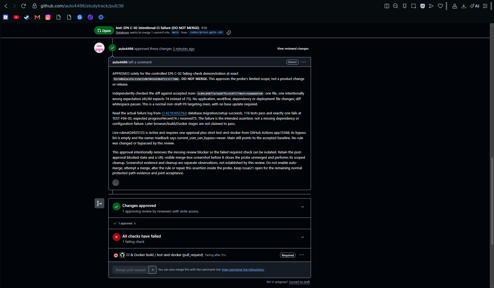

# EP6 execution evidence: required merge gate and identity setup

## Finalization checkpoint - 12 November 2026

The configuration, negative proof, legitimate protected staging path and requested evidence are ready for final peer review. The latest human-operated read-only provider describe returns the exact approved five-part condition and both mappings: the earlier image showed only the field's tail, not a missing guard. No IAM update or new deployment was necessary. [Issue #21](https://github.com/auto4496/studytrack/issues/21) stays open for A's final evidence acceptance and the reviewed main release. Actual keyless credential exchange/deployment remains a separate EP7 check, not an outstanding EP6 configuration action.

| Case | Finalization observation |
| --- | --- |
| EP6-G01 | Fresh GitHub numeric-ID/immutable-subject readback matches the accepted contract |
| EP6-G02 | Human-operated exact-scope policy readbacks match project Run Developer, repository Writer and actAs on runner/migrator; zero user-managed keys |
| EP6-G03 | Current persisted condition has all five numeric-ID/main/deploy.yml/demo guards, with both exact mappings; Enabled provider is visible in the upper screenshot. Latest CLI response omitted requested state/disabled fields, so no new state value is invented |
| EP6-G04 | Fresh environment/variables/branch-policy reads match demo, four exact variables and main-only deployment; supplied image is corroborated where values are clipped |
| EP6-G05 | Fresh active main/staging rules match one approval, strict expected-app check and empty bypass; settings image plus accepted API/C02 evidence cover the controls |
| EP6-G06 | Approved normal PR36 remained blocked by the intended failed Required check; original image and before/after readbacks retained |
| EP6-G07 | PR36 closed unmerged, only probe branches removed, history retained/main unchanged; legitimate green PR37 was A-approved and merged through protected staging |
| EP6-G08 | All requested observation types collected; finalization peer acceptance and reviewed main release are still pending |

New evidence: [finalization folder](../../../artifacts/evidence/lab5-cloud/ep6/2026-11-12-finalization/README.md), [operator's complete saved-provider readback](../../../artifacts/evidence/lab5-cloud/ep6/2026-11-12-finalization/operator-persisted-provider-readback.yaml), [comparison/provenance](../../../artifacts/evidence/lab5-cloud/ep6/2026-11-12-finalization/persisted-provider-assessment.json), and [manifest](../../../artifacts/evidence/lab5-cloud/ep6/2026-11-12-finalization/sha256.json). Human GCP outputs are explicitly distinguished from B's directly authenticated GitHub readbacks. Source images with the project number remain private; submitted PDFs embed only redacted content for those pages, with original/output hashes retained. No synthetic screenshot or unseen UI field is claimed.

## Dated observation history

The following paragraphs preserve the scope and status when each observation was made. Earlier pending statements are superseded by the finalization checkpoint above; the accepted 10 November raw evidence folder remains unchanged.

10 November 2026 (Asia/Bangkok), member B / Datakung. [Issue #21](https://github.com/auto4496/studytrack/issues/21) remains open. The C-02 failing-PR demonstration and scoped cleanup are complete; GCP scope readbacks, the legitimate protected green-PR path and joint evidence acceptance/release remain pending. Successful WIF authentication/deployment is an EP7 observation, not established here.

12 November readback update: A approved the exact evidence head69e117f in [review5843891205](https://github.com/auto4496/studytrack/pull/37#pullrequestreview-5843891205) and merged PR37 into protected staging at6274b17891e304b3ba315c2ed033213837f78d1d on10November14:54:19Z, after required CI42784299461 succeeded. B fetched staging and verified both entire trees equal a839838cf6d306ba5288649ae67196781a53fa4f. The legitimate protected staging path is now observed. Main remains5c04cd4. GCP exact-scope readbacks/Console evidence, final joint acceptance and reviewed main release still remain; dated pending statements below retain their original pre-merge scope.

## Reviewed plan and actors

A approved [PR #34](https://github.com/auto4496/studytrack/pull/34) at `80de8df05f7d535e777c971805ac2f6c42eff7bb`, including the main/staging gate and immutable WIF condition in the [contract](ep6-gate-identity.md). A configured repository settings and reviewed the probe. The B-side human operator ran the GCP commands and supplied their output and the original browser screenshot. B's tooling performed local tests, independent GitHub readbacks, PR creation/linkage, evidence verification and cleanup. No actor's review is substituted for another actor's execution.

Accepted main was and remains `5c04cd4bf7a7a28ff5c429f3770efc42da6bd7e0`. This documentation branch starts at accepted staging `f21e561a32f4414b72c38abb9cf197e1ac46fef8`, including reviewed F05 PR35. The intentionally failing probe never entered either accepted branch.

## GitHub settings actually read back

Evidence files are in [the execution folder](../../../artifacts/evidence/lab5-cloud/ep6/2026-11-10-c02/README.md), with [SHA-256 manifest](../../../artifacts/evidence/lab5-cloud/ep6/2026-11-10-c02/sha256.json).

| Item | Actual observation |
| --- | --- |
| Environment | `demo`; custom deployment branch policy, a single rule of type branch named `main` |
| Variables | Exactly `GCP_PROJECT_ID=studytrack-cpe334`, `GCP_REGION=asia-southeast1`, the reviewed `github-actions/providers/github-main` full provider path and `studytrack-deployer` service-account email |
| Identity contract | Immutable subject prefix `repo:auto4496@137795002/studytrack@1443962980`; GitHub environment suffix `:environment:demo` |
| Ruleset | [26925123](https://github.com/auto4496/studytrack/rules/26925123), Active; exact main and codex/sprint-1-staging targets, no exclusions |
| Review/check | One approval, dismiss stale approvals, resolve review threads; strict `test-and-docker` from GitHub Actions app15368; deletion/force-push protection |
| Bypass | GraphQL `bypassActors` returned totalCount0/nodes[]; B cannot bypass. A separately confirmed the empty list. REST omits bypass actors for B, so omission alone was not treated as proof |

Observed default parameters additionally allow merge/squash/rebase and set `require_extra_approval_for_unattributed_changes=true`; merge commits remain available. Environment `can_admins_bypass=true` is a separate field, not the branch-ruleset bypass list. The accepted plan did not require an environment reviewer/wait timer. All original readbacks are retained.

## C-02 normal failing PR and post-approval block

[PR #36](https://github.com/auto4496/studytrack/pull/36) was a normal, non-draft PR into main from `codex/prove-gate-c02`. Exact probe `f6330b82a325c119e23d0704565dbdf223377d0e` has accepted main5c04cd4 as its sole parent and changes one assertion only: 45/60 expects intentionally wrong74 instead of correct75 in `server/tests/unit/entry-rules.test.ts`. No product, workflow, dependency or deployment file changed. Actual Development linkage to #21 was added and verified in both directions.

| Stage | Actual result |
| --- | --- |
| Focused original unit file | 19 passed on accepted main before introducing the probe |
| Focused probe unit file | 18 passed, 1 failed at expected74/received75; pure unit imports, no database connection/migration |
| [Hosted CI42781653763](https://github.com/auto4496/studytrack/actions/runs/42781653763) | 116 passed, 1 failed at that same assertion; migration/setup and preceding offline/container checks succeeded; later browser/build/Docker steps skipped |
| [A approval](https://github.com/auto4496/studytrack/pull/36#pullrequestreview-5838791656) | APPROVED exact f6330b8 at 08:25:03Z solely for the controlled demonstration; explicitly DO NOT MERGE |
| Post-approval readback | APPROVED + BLOCKED; required `test-and-docker=FAILURE`; no unresolved review thread; conflict mergeable=true; auto_merge=null; merged=false; base unchanged |

The temporary local dependency-install attempt using offline cache lacked a zod tarball. Normal lockfile installation succeeded before tests. This setup issue is not the red assertion proof.

The human-provided image visibly shows PR36's URL, A's exact-commit approval, Changes approved, failed `test-and-docker` with a Required label and the disabled Merge pull request button. The image was copied byte-for-byte; no synthetic capture or visual edit was used. Its original timestamp is not inferred from the filename or relative UI time.

Image SHA-256: `c3014d2c6c2e7da337c7d2dbdaa5b30f3d74f33925900e3279387f29b25c6f46`.

## Close and cleanup

After preserving the screenshot, B closed PR36 at `2026-11-10T08:30:58Z` (15:30:58 Bangkok). REST confirms CLOSED, merged=false and merged_at=null. The remote probe ref was checked against exact f6330b8 and deleted using a matching SHA lease; B detached the clean local worktree at accepted main and deleted only the local probe branch. Both probe branch refs are absent. Closed PR/review/failed run/commit history and a saved patch remain available. Main still equals5c04cd4. No merge, auto-merge, rule change or bypass was attempted. [Cleanup readback](../../../artifacts/evidence/lab5-cloud/ep6/2026-11-10-c02/cleanup.json).

Independent read-only HTTP checks after cleanup returned200 for the public UI and200 with data.status=ok/service=StudyTrack API for `/api/health`. These establish current public/DB-backed health, not a new authenticated journey or independent image/revision provenance. No cloud mutation was used for this check.

## GCP operator observations and remaining checks

12 November scoped readback: the human operator supplied actual `get-iam-policy` output filtered to the deployer principal. Project studytrack-cpe334 returns only Run Developer in this filtered result; repository studytrack in asia-southeast1 returns Writer; runner and migrator each return Service Account User. Requested condition fields are absent for these grants. The deployer's policy has the exact reviewed repository-attribute principalSet as its sole returned workloadIdentityUser member, and the user-managed key list is[]. These observations match the four reviewed scopes and WIF binding. They do not inventory every inherited/organization-level permission or establish a token exchange. See [operator result excerpt](../../../artifacts/evidence/lab5-cloud/ep6/2026-11-12-finalization/operator-scoped-iam-readback.txt) and [assessment](../../../artifacts/evidence/lab5-cloud/ep6/2026-11-12-finalization/scoped-iam-assessment.json).

The remaining image checklist was rechecked against the complete guide pages75-80: guide6.7 specifically asks for screenshots from6.4(environment),6.5(ruleset) and6.6(blocked failing PR). The last is already retained and accepted. Collect the environment and active-ruleset images from A's existing settings, plus the provider image called for in the accepted contract; extra screenshots of every IAM grant are not required by this checklist. Mask the GCP project-number portions of submitted environment/provider images. Preserve readable settings and original provenance; do not treat JSON readback as an image that was never captured.

The human has now supplied the provider's upper details pane. It visibly shows github-main, the GitHub Actions issuer, Default audience and Enabled provider. At the user's request the GCP project number is redacted in [the evidence PDF](../../../artifacts/evidence/lab5-cloud/ep6/2026-11-12-finalization/provider-details-redacted.pdf). The original screenshot is retained outside the repository. The final PDF embeds only the flattened redacted page, so the original number cannot be recovered by extracting a hidden original image under a covering shape. [Provenance](../../../artifacts/evidence/lab5-cloud/ep6/2026-11-12-finalization/provider-details-provenance.json) records original/output hashes and the redaction rectangle. Mapping and condition are below this screenshot and are still pending; the Usage panel's no-data message is not a successful authentication proof.

The user subsequently supplied A's GitHub settings images as items1,2. [The two-page evidence PDF](../../../artifacts/evidence/lab5-cloud/ep6/2026-11-12-finalization/github-settings-redacted.pdf) retains their URLs and visible settings, with the project number securely redacted from the environment page. Page1 shows environment26803236956 (independently identified as demo by the API), one allowed main branch/zero tags, no environment secrets and all four variable names. Provider/service-account values are truncated on screen; their full exact values come from the existing accepted API readbacks, not visual inference. Page2 shows ruleset26925123 Active, empty bypass and exact main/staging targets. Lower approval/status-check controls are outside the frame; existing active-rule readbacks and the accepted Required-check/blocked-merge proof establish them. These two images complete the environment/upper-ruleset captures in combination with that evidence; no missing lower control is falsely described as visible. [Image/PDF provenance](../../../artifacts/evidence/lab5-cloud/ep6/2026-11-12-finalization/github-settings-provenance.json) records originals/output hashes and limits. Only the provider mapping/condition image remains outstanding before the final evidence review/release.

The provider [attributes image](../../../artifacts/evidence/lab5-cloud/ep6/2026-11-12-finalization/provider-attributes-visible.png) has now arrived. Its URL identifies github-actions/github-main and it visibly confirms both exact mappings. The Condition field viewport shows only the assertion.sub/immutable environment-subject tail; it does not expose the complete five-part expression in one frame. This is not evidence that earlier clauses were removed, nor does an Edit form attest a saved change. Re-read the persisted provider's full attributeCondition using the already-reviewed read-only describe command before final acceptance. The 10 November CLI result remains a dated complete five-clause observation. [Provenance and limits](../../../artifacts/evidence/lab5-cloud/ep6/2026-11-12-finalization/provider-attributes-provenance.json) distinguish the new image from a complete current readback. No project-number redaction is needed for this frame; the visible owner/repository numbers are the required GitHub identity guards.

The B-side operator's pasted Cloud Shell output reports API enablement, creation of `studytrack-deployer`, successful grants of project Run Developer, repository studytrack Writer and actAs on runner/migrator, and zero user-managed keys (`[]`). Subsequent actual CLI readback shows pool `github-actions` and provider `github-main` ACTIVE, the reviewed mappings/issuer/five-part condition and the attribute-scoped `workloadIdentityUser` binding on the deployer. The [execution record](ep6-record.json) distinguishes this human-supplied evidence from B's independent GitHub API readbacks. B has no independently authenticated GCP connection.

The preceding paragraph retains the original pre-readback checkpoint. Role scopes have now been compared with the accepted [deployer contract](ep6-gate-identity.md#3-guide-62-proposed-deployer-permissions); the remaining images are listed in the 12 November update above. No raw tokens, passwords, connection strings or service-account key JSON belong in the evidence. Mask project-number portions of submitted screenshots as instructed by the guide; the GitHub probe screenshot above contains no project number. Successful actual credential exchange remains NOT RUN until the separately reviewed EP7 workflow.

The legitimate protected green-PR path must still be observed under the now-active rules, followed by A review of this evidence and the reviewed staging/main handoff. This documentation PR can exercise the staging path after CI passes and A approves; do not treat the older pre-gate PR30 CI as proof of the new enforcement. Use reviewed main-to-staging sync PRs if strict up-to-date checks require synchronization. Issue21 stays open for these remaining criteria; #22/#23/#24 remain separate.
