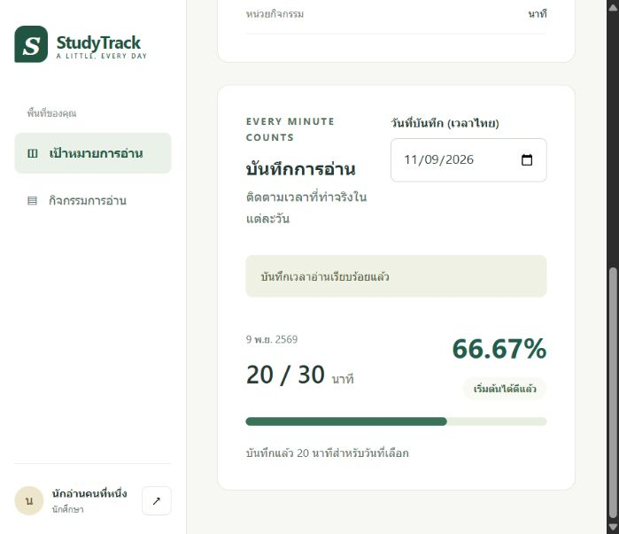
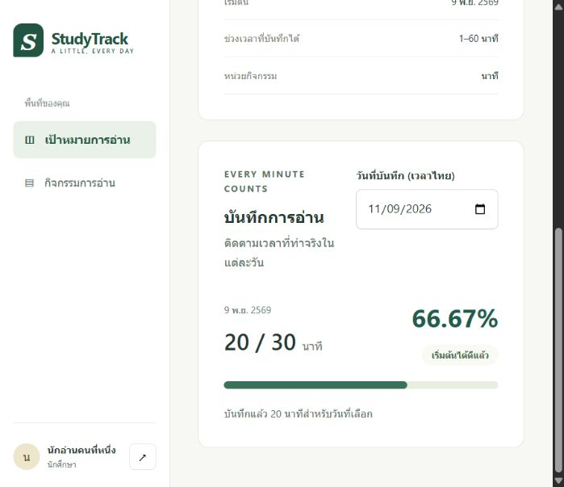
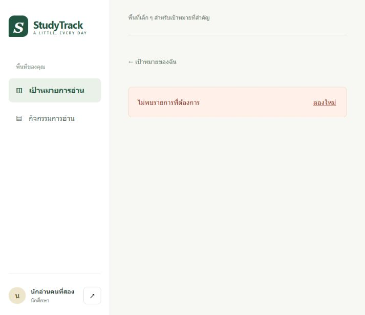

# Member A: live workflow verification

9 November 2026 (Asia/Bangkok). Phanuwit Butchari (`auto4496`) tested the public StudyTrack application with Codex observing the browser. This is the A-side C-04 / R-03 evidence for [Issue #20](https://github.com/auto4496/studytrack/issues/20), supplementing the [B deployment record](ep5-evidence.md). A's own captures establish the workflow below; receiving B's private screenshot bundle is not a prerequisite for these independently reproduced results.

## Service and version provenance

- Public origin: <https://studytrack-981693883236.asia-southeast1.run.app>.
- Tested goal: <https://studytrack-981693883236.asia-southeast1.run.app/goals/ef016b96-0f77-4ca6-ae68-0a6d58c9877a>.
- Reported deployed application source: `807ed0806a84f39e88e0ba8f8fa5e658f41fe97f`, accepted through [PR #27](https://github.com/auto4496/studytrack/pull/27). B's deployment record maps this source to revision `studytrack-00001-rtr` and the runtime/tools digests. A checked the matching main SHA and reviewed that record; the browser round did not independently inspect Cloud Run's current revision or the runtime OCI label. The screenshots establish behavior at the public URL, not a new independent image-to-source attestation.
- B's documentation [PR #28](https://github.com/auto4496/studytrack/pull/28) was [approved by A](https://github.com/auto4496/studytrack/pull/28#pullrequestreview-5819022400) at `8596d13dd4dea312cb3ae6f87e88efac9ec512fe`, then merged into staging as `0bceb1a53e1d69cefa4b70354d1b90ede65459da`.
- This evidence change contains no application or infrastructure changes and does not deploy a new version.

## Actual actions and results

| Check | Actor and observed evidence | Result |
| --- | --- | --- |
| Manager sign-in | User entered the privately received credentials. Codex observed the authenticated manager template-creation form on the public origin. | Passed |
| Activity and personal goal | User performed the create/switch/goal actions. Codex subsequently observed student1's goal for `ทดสอบ Cloud โดย Phanuwit`, range 1-60 minutes, target 30 minutes, starting 9 November 2026. Intermediate create/save clicks were not separately captured by Codex. | Resulting goal observed |
| Save and progress | Codex observed the save-success notice, saved entry dated 9 November, 20/30 minutes and 66.67%. | Passed; 20 / 30 rounds to 66.67% |
| Persisted retrieval | User confirmed refreshing. Codex observed the same goal/date and 20/30, 66.67%, with the transient success notice absent. | Passed after user-confirmed page reload |
| Cross-owner restriction | User signed in as student2. Codex observed that identity, navigated directly to the same student1 goal URL, and observed `ไม่พบรายการที่ต้องการ` without the owner's goal details or saved minutes. | Passed; browser-observed denial |
| Public HTTP smoke | Codex fetched the public root, DB-backed health route and unauthenticated goals route separately. See the timestamped [HTTP record](../../../artifacts/evidence/lab5-cloud/member-a/public-http.json). | Exact statuses and health response retained in that record |

The actual saved value is 20 minutes. The earlier checklist's 15-minute example was not the performed test. C-04 requires one rule rejection **or** access restriction; the observed cross-owner denial supplies that check. Invalid-zero validation was not exercised in this A round and is not claimed. The page's not-found text does not establish an independently captured HTTP 404.

## Browser figures

These are original browser-content captures, without browser chrome or an address bar. The source URL observed by browser automation is recorded with each figure and in the [attributed capture record](../../../artifacts/evidence/lab5-cloud/member-a/acceptance.json). Preserve the visible source-URL captions when using these figures in the final evidence report. Capture hashes are in that record; no password, session value or connection string appears in the figures.

**Figure A1. C-04 / R-03: saved reading entry, 20/30 minutes, 66.67%, with success notice.** Source URL: <https://studytrack-981693883236.asia-southeast1.run.app/goals/ef016b96-0f77-4ca6-ae68-0a6d58c9877a>. User saved the entry; Codex captured the resulting browser state on 9 November 2026.

**Figure A2. C-04 / R-03: the same saved entry after user-confirmed refresh.** Source URL: <https://studytrack-981693883236.asia-southeast1.run.app/goals/ef016b96-0f77-4ca6-ae68-0a6d58c9877a>. Student1 still sees 20/30 minutes and 66.67%; the transient save notice is absent. This proves retrieval after reload, not C-05 restart/redeploy persistence.

**Figure A3. C-04 / R-03: student2 is denied direct access to student1's goal.** Source URL: <https://studytrack-981693883236.asia-southeast1.run.app/goals/ef016b96-0f77-4ca6-ae68-0a6d58c9877a>. The student2 identity is visible; the page shows a not-found message without the owner's data.

## Review and remaining work

The [A live review](https://github.com/auto4496/studytrack/pull/28#pullrequestreview-5819008256) records the observed workflow; the [final approval](https://github.com/auto4496/studytrack/pull/28#pullrequestreview-5819022400) supersedes the earlier request to wait for B's entire private bundle. B's Console/build/resource observations retain their B-side attribution. A does not claim to have independently inspected those private originals, authenticated GCP settings or the serving revision during this browser round.

This follow-up evidence is authored by A and requires B's review before staging acceptance. The reviewed documentation release to main is still pending. Keep #20 open for that handoff/release; do not block the independently reproduced domain workflow on receipt of duplicate B screenshots. Required-check/WIF work [#21](https://github.com/auto4496/studytrack/issues/21), the main deployment pipeline [#22](https://github.com/auto4496/studytrack/issues/22), actual cloud restart/redeploy persistence [#23](https://github.com/auto4496/studytrack/issues/23), and the final Lab5 PDF [#24](https://github.com/auto4496/studytrack/issues/24) remain separate. This record is not instructor acceptance or independent partner-team UAT.
