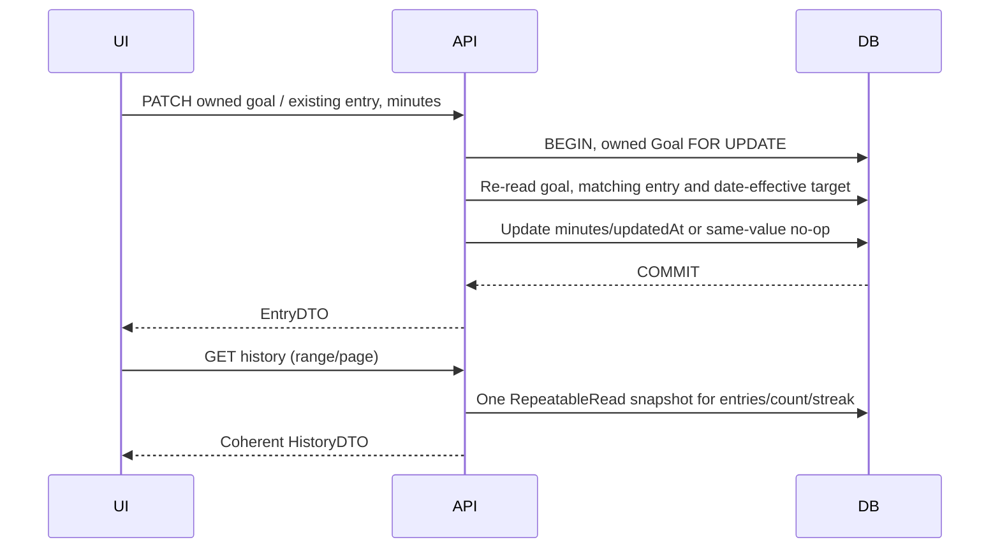

# F-06: owned reading history, minute corrections and streaks

Version0.1 accepted14November2026, Asia/Bangkok. Owner B / Pitchai / Datakung; reviewer A / Phanuwit / auto4496. [Issue58](https://github.com/auto4496/studytrack/issues/58). **ACCEPTED PRE-CODE CONTRACT:** A explicitly accepted all Section2 and shared-interface decisions in [PR59's exact-head review](https://github.com/auto4496/studytrack/pull/59) at1b6bdc5fae4097474a16c5912ab5c4e1afad9aff; owner merged it as d952ad63ea8aacdb7fe67fa6882501a4f78bf5d2. Implementation now follows that accepted staging baseline. [Current execution ledger](../../verification/f06.md) distinguishes local candidate results from pending A implementation review, integration and release. The original proposed wording below records the decisions put to review; these are accepted refinements, not new instructor requirements.

## 1. Sources, baseline and scope

Read against accepted staging **906d1e779c5b4caf61bfd351d8f7e1c9bda9a272**, after PR57. F05 implementation/release and its [F06 handoff](../../verification/f05.md#current-acceptance---13-november-2026) are accepted. [SRS](../../srs.md) FR13/14/15/19 govern this feature; preserve FR04, BR04/05/06/07/08/09/10/11/12 and applicable NFR01-08. Also use the [inventory](../../features.md), [team plan](../../team-plan.md), [Sprint plan](../plan.md), [SDS](../../system-sds.md), [transport/identity contract](../../integration-contract.md), [UI conventions](../../ui-api-conventions.md), [F03 goals](../sprint-1/f03-goals.md), [F04 entries/progress](../sprint-1/f04-entries-progress.md) and accepted [F05 lifecycle contract](f05-lifecycle.md).

Current source inputs: existing [entries router](../../../server/src/features/entries/router.ts), [entry rules](../../../server/src/features/entries/rules.ts), [entry services](../../../server/src/features/entries/service.ts), [goal readers/targetForDate](../../../server/src/features/goals/service.ts), [lifecycle locks](../../../server/src/features/goals/lifecycle.ts), [Clock](../../../server/src/clock.ts), [GoalDetail](../../../client/src/features/goals/GoalDetail.tsx), [DailyActivity](../../../client/src/features/entries/DailyActivity.tsx) and [schema](../../../server/prisma/schema.prisma). These demonstrate available interfaces, not implemented F06 endpoints.

The participant selects an owned active/archived goal, reads paged history for an inclusive date range, corrects minutes of an existing entry and sees its recomputed progress and goal-wide current/best streak. No delete, entry-date move, goal reassignment, entry creation/upsert through correction, audit-log feature, public/manager history, external delivery or F08 period summary is added. F07 remains A-owned; [schedule days never redefine streak eligibility](../sprint-3/f07-schedule.md). Fixed Lab5 cloud evidence records remain untouched.

## 2. Decisions for A review before code

| Decision | Proposed behavior / rationale |
| --- | --- |
| Goal filtering | History is scoped by `/goals/:goalId`, selected through the existing own-goal list/detail navigation including archived goals. No cross-goal aggregate feed is required for FR13; switching goals supplies the goal filter and never merges private records. |
| Aggregate read | New GET history returns one `HistoryDTO` object in `{data:...}`, containing paged entries, pagination, server date context and goal-wide streak from one snapshot. It is an aggregate resource; existing F04 collection/progress DTOs, paths and list pagination are unchanged. This explicit envelope refinement needs A agreement. |
| Date filter | Omit both from/to for the full eligible interval; otherwise supply both, inclusive and valid within the eligible interval. No silent clamp, one-sided inference or browser-selected today. Page defaults1/size20, size max100 and existing page max1,000,000. |
| Future goal | Unfiltered history is200 with empty entries/total0, eligibleTo=null, filter bounds=null and zero/null streak. An explicit range with no eligible dates is422. Do not query a future date through the existing progress endpoint or invent a failure for ordinary empty future history. |
| Correction | PATCH only `{minutes}` on an existing entry beneath its owned goal. Preserve ID,goal,date,createdAt,goal status/snapshots/target versions and row count. No optional owner/date/target fields or upsert. |
| Archived goal | Historical correction is allowed within startDate..min(endDate,today), inclusive, without reopening the goal. This deliberately differs from F05's archived target-change409. Inactive template metadata does not control an existing goal's history/correction bounds. |
| Retry/concurrent writes | PATCH sets an absolute value. Identical current value is a no-op preserving updatedAt. Competing legal corrections serialize; last serialized successful commit wins. No optimistic version/ETag or invented409 is promised; updatedAt is a timestamp, not a unique concurrency token. UI reconciles an uncertain result before any explicit manual new write. |
| Historical target | Resolve the version effective on each stored entryDate, including during correction. Never use today's GoalDTO target or the current template's bounds to recompute an older row. Preserve HALF_UP two-decimal progress, uncapped percentage and exact actual>=target achieved. |
| Streak domain | Both counts use achieved dates over the entire eligible goal history, independent of the history filter/page, other goals and F07 schedules. Missing dates and under-target entries break adjacency; mere logging is not achievement. |
| Current streak | Follow BR09 literally: end at server Bangkok today if today is eligible/achieved; otherwise only yesterday may anchor it if eligible/achieved. No older fallback. For an archive older than yesterday, current=0; do not silently freeze a terminal streak at endDate. Best history remains retained. |
| Best ties | Longest achieved run across eligible history; when equal lengths exist choose the earliest start date deterministically. Zero counts have null start/end dates. |
| Storage | Reuse DailyEntry, Goal and GoalTargetVersion and their existing constraints/indexes; no stored streak cache, correction-version column, new dependency or migration is proposed. If implementation reveals a justified shared/schema change, refine/review this contract first. |

These are concrete proposed refinements, not new instructor mandates. A should explicitly accept the aggregate envelope, paired range/future response, absolute last-writer semantics, archive-relative current-streak choice, best tie and UI refresh boundary before code.

## 3. API, validation and safe DTOs

Reuse Participant authentication, cookie/Origin/CSRF, safe error/requestId/fields envelopes and no-store behavior. Never accept ownerId/userId/role, goal/entry IDs inside body, target, achieved, progress, timestamps, clock/date override or timezone from the client.

| Method/path | Request | Success / important errors |
| --- | --- | --- |
| GET `/api/goals/:goalId/history` | Own Participant goal; only optional page/pageSize and paired from/to query; no mutation body |200 `{data:HistoryDTO}` including a normal empty result;400 malformed UUID/date syntax;422 shape/calendar/range/pagination |
| PATCH `/api/goals/:goalId/entries/:entryId` | Own Participant goal and matching existing entry; strict JSON `{minutes: integer}`; no query; existing Origin/CSRF guards |200 `{data:EntryDTO}` using existing F04 fields;404 wrong parent/foreign/absent resource;422 invalid fields/minutes/stored date eligibility; safe500/rollback |

For valid parsed requests: anonymous/expired/revoked401, wrong role403; valid-shape absent/unowned goals and absent/wrong-parent/foreign entries are indistinguishable404 without private values. Authorize the goal before any entry lookup or lifecycle/date disclosure. Malformed UUID is400 INVALID_ID; date syntax400 INVALID_DATE, nonexistent calendar date/order/out-of-bounds422 VALIDATION_ERROR with from/to fields. Reject duplicate/array/object query values, missing paired bound, unknown fields, fractional/string/boolean/null minutes and noncanonical pagination. Existing pagination accepts positive integer strings; retain its limits/defaults. PATCH missing/wrong Origin/CSRF403, malformed JSON400 and unsupported media type415 with otherwise valid guards. The existing global JSON parser can reject malformed JSON before route authentication; do not claim a changed global precedence or use a multiply invalid request as an unambiguous access test.

GET also rejects a nonempty parsed input body with422; an absent/empty body has no domain input. The wire `EntryDTO` is unchanged: id,goalId,entryDate,minutes,targetMinutes,progressPercent,achieved,createdAt,updatedAt. Only the stored entry's minutes and, on an actual change, updatedAt change; target/progress fields are derived server-side. No owner/session/internal SQL fields are exposed.

```json
{"minutes": 45}
```

```ts
interface HistoryDTO {
  goalId: string;
  evaluatedAt: string; // single injected server Clock instant, ISO8601 UTC
  today: string;       // YYYY-MM-DD in Asia/Bangkok for that instant
  eligibleRange: { from: string; to: string | null }; // startDate..min(endDate,today)
  filter: { from: string | null; to: string | null }; // effective inclusive display range
  entries: EntryDTO[];
  pagination: { page: number; pageSize: number; total: number }; // filtered count
  streak: {
    current: number; best: number;
    currentStartDate: string | null; currentEndDate: string | null;
    bestStartDate: string | null; bestEndDate: string | null;
  };
}
```

Normal unfiltered context has filter.from=startDate/filter.to=eligibleTo. A future-start goal has eligibleRange.from=startDate/eligibleRange.to=null and both filter bounds=null; the requested valid pagination values are still returned. A filtered empty interval is valid200 when its dates are eligible; page beyond total is also200[], preserving total and the independent goal-wide streak. Sort entries entryDate DESC,id ASC as F04. Filter/page changes never narrow the streak scan. No client-controlled asOf/date override, separate F06 streak endpoint or partial bulk correction is proposed.

## 4. Streak rules and deterministic examples

Take only dates inside the eligible interval. Resolve each entry's effective target on its own date; qualify only actual>=target, before percentage rounding. Walk achieved local dates in ascending order: adjacent dates differ by exactly one calendar day; missing or under-target days produce gaps. Best is the longest run with earliest-start tie-breaking. Current uses only a qualifying today or, failing that, qualifying yesterday; count the contiguous run ending there. If neither qualifies, current=0, even if an older run is long. Do not carry a streak across goals or skip unscheduled weekdays. No eligible dates or no achieved dates yields0 counts/null endpoints.

Use local DATE values with calendar arithmetic, not elapsed browser hours or local-machine timezone. Best considers all eligible history even when the displayed page is small. Do not impose an undocumented90-day cap or materialize/cache streaks. Read relevant entries/target versions efficiently; avoid one database query or loop iteration per missing calendar day. A pure lookup over loaded target versions may mirror the accepted targetForDate semantics, with parity tests against that service; it must not change the shared helper's semantics. No new performance SLA is asserted without measurement.

One sequential example, fixed Bangkok today=2026-11-09: create the synthetic goal with the injected server clock at its start2026-11-01, then advance it; schedule target60 on11-05 for11-06 using the accepted F05 behavior. Target is30 through11-05 and60 from11-06. Entries are11-01:30,11-02:45,11-04:30,11-05:20,11-06:60,11-07:70,11-08:60;11-03 and today are absent.

| Step | Expected history/progress | Current / best |
| --- | --- | --- |
| Initial read |11-05 uses30,20/30=66.67%,false;11-06 uses60,100%,true |3 /3, both11-06..11-08; today missing permits yesterday anchor |
| Filter11-01..11-02,pageSize1 | One row visible, filtered total2; no mutation | Still3 /3 from whole eligible history |
| Correct11-05 to30 | Same entry identity/date;30/30=100%,true, not30/60 |5 /5, both11-04..11-08 |
| Then correct11-07 to50 | Same entry;50/60=83.33%,false; splits the run |1 (11-08) /3 (11-04..11-06) |

Separate tie fixture: equal two-day runs11-01..02 and11-06..07 choose11-01..02 for best. For an archive ended before yesterday, current is0 while best/endpoints remain available. Current may end on yesterday when endDate=yesterday and that date qualifies; on the next day it becomes0. The UI labels current as of returned today and explains archived behavior rather than presenting it as data loss.

## 5. Persistence, locking and consistency

History GET uses one RepeatableRead transaction: owner-scoped goal lookup establishes authorization/snapshot, capture one server Clock instant, then derive bounds, page/count, historical targets and lifetime streak from that same snapshot. An overlapping correction/stop/target change can yield a complete before or after view, never mixed list/count/target/streak states. Reads do not update rows, timestamps, sessions through domain logic or cache tables. Existing security-session bootstrap behavior is separate.

Correction PATCH: validate transport/IDs/shape; acquire the existing owner-scoped Goal FOR UPDATE, re-read/authorize, capture one post-lock Clock instant, then find the entry constrained by both entryId and goalId. Revalidate its immutable stored date against startDate..min(endDate,today), and minutes against immutable goal bounds. Resolve the target effective on that stored date. If minutes are identical, return the current EntryDTO with no write. Otherwise update only minutes/updatedAt, read the derived EntryDTO in the transaction and commit before responding. Keep createdAt, uniqueness, target versions and all other records unchanged. A failure after update but before commit rolls everything back, including timestamps; return a safe error, never SQL/stack details.

Lock order is Goal -> entry. Never lock an entry before its goal or acquire a template lock for a correction. F05 target/stop writers take the same Goal FOR UPDATE; F04 entry creation takes Goal FOR SHARE, so these paths serialize compatibly. A legal historical correction before or after stop remains legal under inclusive endDate; do not introduce a blanket archived409. Two legal corrections have a defined whole-value last-serialized winner, including different entries under one goal. GET retains RepeatableRead; PATCH uses ReadCommitted and re-reads after its lock. No stale pre-lock authorization, clock or target snapshot may determine the write. No CAS guarantee is inferred from equal millisecond timestamps.



The correction response and a later history/progress response are separate operations and may observe a later concurrent commit; do not claim cross-request atomicity. `HistoryDTO` itself is coherent. The UI invalidates old derived views and displays refreshed authoritative values; it does not combine a patched value with a stale lifetime streak as one completed snapshot.

## 6. UI, shared integration and recovery

Add a separate ReadingHistory panel on owned GoalDetail, labelled **ประวัติการอ่าน**, with the current goal context/back-to-own-goals navigation, paired inclusive date inputs, Apply/reset, pagination, entries showing date/minutes/date-effective target/progress/achieved and per-entry **แก้ไขเวลา**. Streak cards explicitly say they cover the whole goal and show the server today/as-of context, not the visible range. Future goals show a meaningful empty/not-started state; archived goals retain eligible correction controls and explain current versus best. Use immutable snapshot bounds and current owned GoalDTO context, never the active template catalogue.

Open one labelled integer minute editor for an existing row, preserve input on validation, focus field errors and offer Save/Cancel. Disable duplicate saves and conflicting date/page/edit controls while pending or outcome-uncertain. A successful PATCH triggers a fresh HistoryDTO read. Clear/mark old derived results as refreshing rather than claiming stale values are updated. Failed reads retain clear error/retry state, not fabricated empty success. Server date/bounds are authoritative even when the browser clock/zone differ. Refetch on opening, focus/manual refresh and confirmed writes; show the evaluation date. This contract does not promise real-time updates while an idle tab never refreshes.

Coordinate an additive optional `entriesRevision` and `onEntriesChanged` prop at the existing GoalActivityProps boundary with A. GoalDetail hosts the history panel and propagates invalidation: confirmed F04 creation/reconciliation refreshes history/streak; confirmed F06 correction refreshes the selected-day F04 progress. A selected historical date and unrelated unsaved minute inputs should survive an entry refresh; if authoritative data makes an input ineligible, explain/block its submission rather than silently discarding or replaying it. Do not reuse the lifecycle remount key to reset it unnecessarily, emit change callbacks from every ordinary GET or introduce refresh loops. Preserve F05 target/stop refresh behavior and PR51's date guidance. The proposed prop names/GoalDetail insertion are integration decisions for A review; they are not changed in this PR. F07's future isolated panel may consume an agreed invalidation signal later, but F06 has no schedule dependency or schema edit.

On uncertain PATCH transport/5xx outcome, do not blindly replay. Read the same owned history resource with from=to=the immutable edited date/page1: uniqueness makes the single existing entry identifiable even when the displayed filter/page excluded it. Compare the expected entry ID and authoritative current value, then refresh the normal history view; do not infer which competing request caused that value. If reconciliation fails, block retry until a safe read succeeds. A differing current value is presented for an explicit new manual edit; last-writer semantics do not justify silently overwriting it. Missing/unavailable entry or changed eligibility gets a safe explanation, not an upsert. On401 clear private state through shared auth and require sign-in without replay. Invalidate/abort obsolete GETs and ignore late responses across goal/range/page changes/unmount; a client abort is not proof a PATCH failed to commit.

Verify390x844 and1440x900 with real API/DB, readable rows/cards, keyboard labels/focus/error associations and no horizontal page overflow. Do not replace existing create/progress/history controls with mock-only figures. Selecting another owned goal or an archived goal proves the goal filter; managers/foreign goals expose no history panel or data. No charts, leaderboard, all-user summary or notification UI is required for this feature.

## 7. Planned AC / software test specification

The22 AC-F06/TEST-F06 pairs below are the accepted test specification. Actual source, assertions, retained failures and execution results are mapped in the [verification ledger](../../verification/f06.md); this specification alone is not execution evidence or implementation acceptance.

| AC / TEST-F06 | Preconditions and action | Required observable result |
| --- | --- | --- |
| AC-F06-01 / TEST-F06-01 | Own active goals with multiple persisted dates; GET unfiltered history, switch owned goal | Correct private goal context, descending rows and canonical bounds; coherent full-goal streak; no writes or cross-goal merge |
| AC-F06-02 / TEST-F06-02 | Inclusive paired range, single-day range, empty eligible range, page1/2 and page beyond total | Exact filtered rows/count/order/defaults/limits; empty200 preserved; same goal-wide streak across all filters/pages |
| AC-F06-03 / TEST-F06-03 | Missing paired bound, reversed/from-before-start/to-after-end/tomorrow, malformed/impossible dates, array/duplicate/unknown query, invalid pagination | Defined400/422 and from/to/field errors; no mutation, silent clamp or unexpected500 |
| AC-F06-04 / TEST-F06-04 | Historical target revisions and changed current template; ratios20/30,1/32,75/60; compare existing F04 reads | Per-date target parity,66.67/3.13/125%, exact achieved; immutable snapshot bounds/title, no current-target substitution |
| AC-F06-05 / TEST-F06-05 | Correct an existing eligible entry, reload then same-value retry | Minutes/progress change; ID/goal/date/createdAt/count/versions unchanged; no-op preserves updatedAt and values |
| AC-F06-06 / TEST-F06-06 | Snapshot min/max boundaries;0/outside/fraction/string/boolean/null/missing; injected date/owner/target/progress/ID/timestamp fields | Only exact integer minutes payload accepted; invalid422, prior row/timestamps/other tables unchanged |
| AC-F06-07 / TEST-F06-07 | Future goal default read; archive and correct start/end boundary; injected invalid stored-date fixture; retries after stop | Future200 empty/null context; allowed archived historical changes, invalid date422; no reopening/date move/target mutation |
| AC-F06-08 / TEST-F06-08 | Deactivate/edit template after goal/entry; history and correction within snapshots | Existing goal remains usable and labelled by snapshot; inactive catalogue/range drift never blocks or alters its history |
| AC-F06-09 / TEST-F06-09 | Achieved/under-target/missing consecutive dates; another goal/user on gaps; unscheduled days | Calendar gaps/under-target break runs; no streak across goals/users or F07 weekday skipping; logging alone insufficient |
| AC-F06-10 / TEST-F06-10 | Today achieved, today partial/missing with yesterday achieved, yesterday missing, empty/start-today/future | Exact today/yesterday current anchor; no older fallback; correct0/null endpoints and server as-of date |
| AC-F06-11 / TEST-F06-11 | Several equal best runs, sparse multi-year gap and small filtered/page window | Earliest-start best tie, lifetime result unchanged by display range/page; no hidden cap or loop over every absent day |
| AC-F06-12 / TEST-F06-12 | Sequential Section4 target-version example; correct11-05 then11-07 | Current/best3/3 ->5/5 ->1/3, correct run endpoints and per-date percentages; no rows/versions recreated |
| AC-F06-13 / TEST-F06-13 | Archive ended today/yesterday/older; fixed Clock across16:59:59Z/17:00:00Z, Sunday/Monday/month/year/leap boundaries | BR09 current remains today-relative, old archive current0/best retained; Bangkok dates/adjacency/recalculation exact |
| AC-F06-14 / TEST-F06-14 | Valid parsed requests under anonymous/expired/revoked, manager, other participant, absent/foreign/wrong-parent entry |401/403/404 matrix and safe identical private-not-found shapes for both routes; no returned private fields/write |
| AC-F06-15 / TEST-F06-15 | PATCH wrong/missing CSRF or Origin, malformed UUID/JSON, non-JSON, query/body injection, forced DB error | Existing400/403/415/422/safe500 boundaries with other conditions valid; no SQL/stack/credential leakage or global middleware rewrite |
| AC-F06-16 / TEST-F06-16 | Real DB barriers/two connections force same-entry and distinct-entry corrections in both Goal-lock orders | Serialized absolute values, single original identities/counts, defined last successful winner and coherent recomputation; no timestamp-as-version assumption |
| AC-F06-17 / TEST-F06-17 | Force correction-versus-stop, target-change and entry-create orders; writer blocked across midnight | Post-lock clock/range/target rules hold; legal archive correction succeeds in either order; target history/endDate/uniqueness preserved, no lock inversion/deadlock |
| AC-F06-18 / TEST-F06-18 | Pause GET after first snapshot read; commit correction/stop before remaining reads | Entire aggregate is an allowed before/after snapshot, never torn page/count/targets/streak; GET does not mutate |
| AC-F06-19 / TEST-F06-19 | Inject transaction failure after actual update but before DTO/commit | Safe500, full rollback of original minutes/updatedAt; Goal/entry identity/createdAt/versions/counts unchanged |
| AC-F06-20 / TEST-F06-20 | Real desktop/mobile two-goal history/filter/page/edit/reload; existing daily create and selected-date progress | Persisted correction and coherent history/streak; bidirectional invalidation preserves selected date, F05 behavior and date guidance; accessible no-overflow states |
| AC-F06-21 / TEST-F06-21 | Delayed stale GET; refresh during unsaved daily/history input; committed-but-lost PATCH; failed reconciliation; competing edit; page/goal switch;401 | No silent input loss, stale private overwrite, automatic replay/upsert or mixed completed UI; exact-date safe read before manual retry; auth clear and obsolete-read cleanup |
| AC-F06-22 / TEST-F06-22 | Save/correct with isolated DB, stop/start actual local API without reseed; full F01-F05 regression/build and browser clock differing from server | Same original identity/values/session/history/streak retrieved, accepted baseline preserved and server-clock authority holds; do not claim unimplemented F07/F08 coverage |

Use unit tests for streak/date/target boundaries and real PostgreSQL/API transactions for persistence/access/races/rollback. Concurrency requires explicit barriers/observed ordering, not an unordered Promise.all alone. Fixtures may use the injected Clock and isolated synthetic data; they must not introduce client clock overrides or mutate existing/cloud records. Actual browser journeys use the real backend/DB. Anticipated test locations are new streak-rules/history integration/browser files plus existing F04/F05 regression; record actual names rather than pretending planned files already exist.

## 8. Implementation handoff and completion gates

After A accepts/revises this specification, create an isolated implementation branch from accepted staging. First capture a meaningful red for absent history/correction/streak behavior after valid auth/DB setup; a missing dependency or unavailable DB is not a domain red. Then implement the protected aggregate/history and correction service, pure streak rules, isolated UI and reviewed optional invalidation boundary; map every accepted AC to real execution/source and retain observed failures. No F06 code, migration or runnable test is included here.

Anticipated B changes: new entry history/streak modules/tests, additive entries-router mounts, smallest shared DTO helper/type reuse, ReadingHistory panel and reviewed GoalDetail/DailyActivity refresh props, styles only as needed for required states/viewports. Coordinate shared GoalDetail/API DTO changes with A's future GoalSchedulePanel before code. No auth/error/Clock rewrite, target-version semantics change, migration edit, dependency/CI/deployment change or F07 schedule implementation is planned. A's F05 goal/stop contract remains authoritative.

DoD: accepted contract -> meaningful red/green and real DB/API/browser/restart/regression/build evidence -> A implementation review -> protected staging integration -> separate reviewed release/identified running version as required by the team. Contract approval keeps Issue58 OPEN and does not accept implementation/release or declare Sprint2 complete. F08 summaries remain B's separate Sprint3 work after appropriate dependency/contract review; feature work does not replace Lab6 inter-team UAT or Lab7 maintenance evidence.
