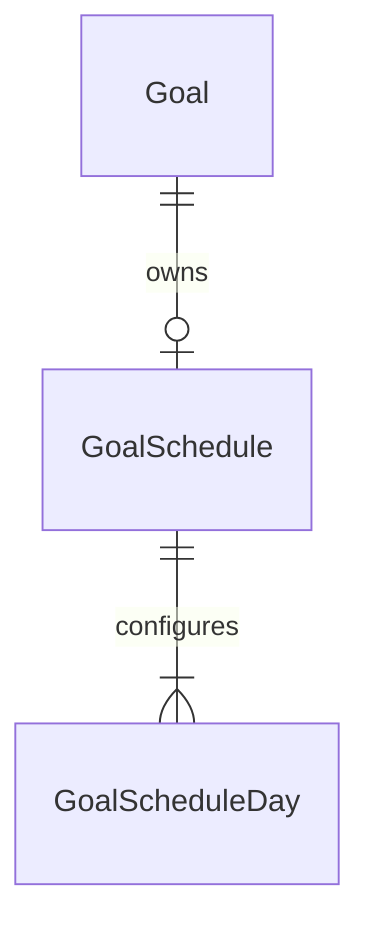

# F-07: reading schedules and in-app reminder contract

Version0.1,13November2026, Asia/Bangkok. Owner A / Phanuwit / auto4496; reviewer B / Pitchai / Datakung. [Issue54](https://github.com/auto4496/studytrack/issues/54). **PROPOSED PRE-CODE CONTRACT: NOT IMPLEMENTED; every F07 test below is NOT_RUN.** B reviews the decisions before implementation. Preparing this contract alongside Lab5/F06 does not declare Sprint2 complete or change feature ownership.

## 1. Sources, scope and dependencies

[SRS](../../srs.md): FR16/FR17/FR19, BR07/BR13, and applicable NFR01-08; retain FR04, BR05/06/08/09/10/11/12 when integrating. [Feature inventory](../../features.md), [team plan](../../team-plan.md), [Sprint plan](../plan.md), [system SDS](../../system-sds.md), [transport/identity contract](../../integration-contract.md), [UI conventions](../../ui-api-conventions.md), [F03](../sprint-1/f03-goals.md) and accepted [F05 lifecycle](../sprint-2/f05-lifecycle.md) supply the baseline. [F05 release acceptance](../../verification/f05.md#current-acceptance---13-november-2026) establishes available lifecycle dependencies.

The participant persists recurring weekdays, intended local reading times and optional reminder times for an owned goal, then reads the configuration and today's server-evaluated reminder state. This is an in-app representation, with no email/SMS/push, browser/OS notification permission, external service, background delivery, automatic reading entry or guaranteed alert delivery. Managers gain no private-data access.

A owns F07. B owns F06 entry corrections/history/streak and F08 summaries; B coordinates Lab5 Issue24 and A reviews that report. F07 reuses existing goal/entry data and does not implement B's features. F06 code is not required to draft F07; implementation still follows accepted contract and the team's Sprint entry decision. No application/schema/migration/test/workflow change is included in this preparation PR.

## 2. Decisions requiring B review

| Decision | Proposed behavior |
| --- | --- |
| Weekly slots | One current schedule per goal,1-7 distinct weekday slots. ISO weekday1=Monday through7=Sunday. Each selected day may have its own reading/reminder time, preserving the SDS's logical per-weekday time. Return slots sorted by weekday; do not silently deduplicate invalid input. |
| Times | Strict ASCII24-hour HH:mm from00:00 through23:59. Server timezone is always Asia/Bangkok; no client-selected timezone, date or UTC offset. Reminder times refer to the same selected local day and must be at or before its reading time. Cross-day reminder offsets are excluded from this proposed increment. |
| Reminder toggle | A single reminderEnabled flag applies to this goal's slots. When true, each selected slot requires reminderTime; when false, each reminderTime must be null. Intended reading times remain saved while reminders are disabled. |
| Replacement | PUT replaces the complete current configuration atomically. Repeating an identical normalized configuration preserves values/createdAt/updatedAt. Concurrent successful replacements serialize; the last serialized commit wins as a whole, without mixed weekday sets. |
| Current configuration | Edits affect the next read immediately, including today's reminder representation. No schedule-version history or past reminder ledger is proposed. Existing entries/target versions and their timestamps are never rewritten. |
| Future goal | An owned future-start ACTIVE goal may save a schedule; its reminder is GOAL_NOT_STARTED until the actual start date. This differs deliberately from F05's target-change/first-stop409: schedule setup changes no target/endDate. |
| Stopped goal | GET retains the stored configuration but evaluates GOAL_ARCHIVED. PUT returns409 GOAL_ARCHIVED. No reopening/deletion of goals or automatic config mutation by the F05 stop endpoint; derived state suppresses reminders after stop commits. |
| Inactive template | An existing eligible goal can still use its schedule after template deactivation; authorize/inspect the goal, without requiring a current active-catalog lookup. |
| Logged versus achieved | Any existing entry for this goal/today suppresses that day's reminder as LOGGED, even20/30. That means activity was recorded, not target achieved. Actual/target/progress/achieved continue to come from existing progress APIs. |
| Independent streak/summary | Unscheduled days still participate in the original daily goal/streak/summary rules. Scheduling never changes entry eligibility, historical denominators, achieved status, streak gaps or F08 period counts. |

These are proposed refinements of FR16/17 and BR13, not instructor-mandated restrictions or already accepted product behavior. B should explicitly accept/revise reminder ordering/toggle, same-day logged suppression, future/archived handling and whole-configuration replacement before code. The small SDS logical row is refined into an aggregate plus weekday children below; it is not a claim that these tables already exist.

## 3. API and DTO

Use the existing envelopes, session role/ownership, JSON/Origin/CSRF guards and safe errors. Never accept ownerId/userId/role, evaluated date/time/status, timezone, timestamps or internal IDs from the client. Validate syntax/shape consistently, authorize an owner-scoped goal before disclosing lifecycle/configuration. Valid-shape foreign and nonexistent goals both return404 NOT_FOUND.

| Method/path | Role / request | Result |
| --- | --- | --- |
| GET `/api/goals/:goalId/schedule` | Participant owner; no body or query parameters | 200 ScheduleDTO, including config=null when that owned goal has no schedule; read-only for active/future/archived goals |
| PUT `/api/goals/:goalId/schedule` | Participant owner; strict full body below, JSON+Origin+CSRF | 200 committed ScheduleDTO;422 invalid fields;409 GOAL_ARCHIVED; safe500 with complete rollback on persistence error |

All endpoints: anonymous/expired/revoked401; wrong role403; malformed UUID400; unknown query/body fields422. PUT also uses bad CSRF/origin403, malformed JSON400 and non-JSON415. Missing config is not a404 when the goal exists and is owned. No PATCH/DELETE, historical-status query, snooze/dismiss or bulk participant endpoint is proposed. Disabling reminders preserves the intended reading schedule.

```json
{
  "reminderEnabled": true,
  "days": [
    {"weekday": 1, "readingTime": "20:00", "reminderTime": "19:45"},
    {"weekday": 3, "readingTime": "18:30", "reminderTime": "18:30"}
  ]
}
```

Each slot requires exactly weekday, readingTime and reminderTime. Reject empty/>7 arrays, repeated weekdays, out-of-range/non-integer/string weekdays, missing/null/wrong-type fields, unknown nested keys, invalid time syntax or enabled/null inconsistencies. No trimming/coercion into a different valid time. When disabled, reminderTime is explicitly null for every slot; readingTime remains required.

Successful GET/PUT returns `{data: ScheduleDTO}`:

```ts
type ReminderStatus = "NOT_CONFIGURED" | "GOAL_ARCHIVED" | "GOAL_NOT_STARTED"
  | "NOT_SCHEDULED" | "DISABLED" | "LOGGED" | "UPCOMING" | "DUE";
interface ScheduleDTO {
  goalId: string;
  timeZone: "Asia/Bangkok";
  config: null | {
    reminderEnabled: boolean;
    days: Array<{weekday: number; readingTime: string; reminderTime: string | null}>;
    createdAt: string; updatedAt: string;
  };
  evaluation: {
    evaluatedAt: string; // one server Clock instant, ISO8601 UTC
    date: string;        // YYYY-MM-DD Bangkok date for that instant
    weekday: number;     // ISO1..7 for that same local date
    status: ReminderStatus;
  };
}
```

No entry contents, credentials, owner identifiers or internal schedule IDs are exposed. Server evaluation uses this precedence, in a single consistent read:

1. No configuration: NOT_CONFIGURED.
2. ARCHIVED goal: GOAL_ARCHIVED; otherwise before startDate: GOAL_NOT_STARTED.
3. Today has no configured slot: NOT_SCHEDULED.
4. Reminders disabled: DISABLED.
5. An entry for this owned goal/today exists: LOGGED, regardless of achieved status.
6. Today's local minute is before the slot's reminder minute: UPCOMING; at/after it: DUE until the local day changes or an entry is recorded.

At Bangkok midnight, recompute the date/weekday and current slot; never carry yesterday's DUE/LOGGED into another day. Reading time is the user's intention, not a new entry deadline or automated achievement. A GET does not write a reminder log, last-seen flag or reading record.

## 4. Additive persistence and transaction design

Propose an additive migration after contract acceptance; do not edit the accepted foundation migration, reset dev/cloud DBs or run seed as a repair. This contract changes no Prisma or SQL file.

| Proposed table | Fields / constraints |
| --- | --- |
| GoalSchedule | UUID id; unique FK goalId to existing Goal; reminderEnabled boolean; createdAt/updatedAt timestamptz(3). Ownership inherits from Goal, with no client-owned ownerId duplicate. |
| GoalScheduleDay | FK scheduleId; weekday smallint CHECK1..7; readingMinute smallint CHECK0..1439; nullable reminderMinute CHECK0..1439 and reminderMinute<=readingMinute when present; composite primary key(scheduleId,weekday). |

Goal rows remain retained under existing lifecycle rules. Parent FK uses restrictive goal deletion; child rows cascade only with their schedule parent. Service validation/transaction enforces1-7 children and global toggle/null consistency; those cross-row invariants are not falsely claimed as ordinary column CHECKs. Unique goalId and composite day keys provide final race/duplicate guards. HH:mm converts to minute-of-day and back deterministically; do not store a timezone-dependent timestamp for a recurring local time.



PUT acquires the existing owner-scoped Goal `FOR UPDATE`, re-reads/authorizes, checks ARCHIVED, then reads/upserts the schedule and complete child set within the same transaction. Lock order is Goal -> schedule -> days; never reverse it or lock templates. This shares F05's goal lock, so replacement-versus-stop has a defined order. A replacement serialized before stop may commit and is then suppressed by the archived goal; one serialized after stop returns409 without changes. Concurrent initial saves cannot create two parents; concurrent replacements cannot interleave child sets. Compare normalized current config before writing so a same-value retry does not invent a new updatedAt. Errors roll back parent, child changes and timestamps together.

GET reads owner goal, schedule/days and today's entry in one RepeatableRead transaction snapshot. PUT uses ReadCommitted with the Goal FOR UPDATE serialization above, re-reads after the lock and returns its own committed configuration/evaluation; do not apply a stale pre-lock snapshot to a competing write. Capture one injected Clock instant per operation (for a writer, after its Goal lock); derive date, weekday and minute in Asia/Bangkok from it. Do not combine a pre-stop goal with a post-stop schedule or consume an uncommitted child set. Entry creation uses its existing Goal FOR SHARE ordering; F06 corrections may alter minutes without changing the definition of LOGGED. F07 requires no change to targetForDate or the F05 stop endpoint.

## 5. UI and recovery

Use an isolated GoalSchedulePanel on the owned goal detail page, with labelled weekday selections and per-day reading/reminder time controls, reminder toggle, explicit Bangkok timezone, Save and a readable today's status. Explain NOT_CONFIGURED and disabled reminders. Show saved values after a full reload. Archived configuration is read-only with a stopped-goal explanation; future goals allow setup and explain when it starts. The existing daily-reading component remains independent.

Load/refetch on opening the panel, returning focus and manual refresh; while visible, a proposed60-second status poll may keep the representation current. This is periodic display refresh, not background notification delivery or a timing guarantee. The server evaluation is authoritative even when browser timezone/clock differ. A status refresh must not overwrite unsaved configuration, move keyboard focus or mix stale requests; use the existing generation/pending patterns.

Disable duplicate Save while pending. Preserve form values on validation errors, focus labelled field errors and show loading/empty/server-error/retry states. If a PUT outcome is uncertain, GET the complete authoritative config before offering manual retry; block blind replay while that read fails. A competing tab can legitimately replace the whole config; show retrieved values and let the user choose a new edit rather than silently replaying old input. On401 clear private data and require sign-in without mutation replay. Cancel obsolete reads/unmount polling. Verify390x844 and1440x900, keyboard labels, error associations and no horizontal page overflow. No browser notification prompt appears.

## 6. Planned acceptance criteria and test specification

**All AC-F07/TEST-F07 cases below are NOT_IMPLEMENTED / NOT_RUN.** IDs are planned assertions, not fabricated test results. Later execution must map actual test names/results/source to these IDs, retaining meaningful red and observed failures.

| AC / TEST-F07 | Action / important preconditions | Required observable result |
| --- | --- | --- |
| AC-F07-01 / TEST-F07-01 | Owned goal without config; GET then save valid different weekday times; new request/full reload | Empty DTO before save; canonical sorted config and persisted coherent days after save; same goal and unchanged entries/targets |
| AC-F07-02 / TEST-F07-02 | Save1 and7 weekday slots; replace subset/time/toggle; identical retry | One parent, exactly committed selected days, coherent whole replacement; same-value retry preserves both timestamps |
| AC-F07-03 / TEST-F07-03 | Empty/>7/duplicate/0/8/fraction/string weekdays, unknown nested/top-level/query fields and wrong types | 422 with no parent/child/domain writes; no silent dedup/coercion |
| AC-F07-04 / TEST-F07-04 |00:00/23:59 and same reminder/reading time; malformed/non-padded/24:00 times; later reminder; enabled/null mismatches | Valid boundaries saved; invalid requests422 without partial writes |
| AC-F07-05 / TEST-F07-05 | Force all state-precedence cases: missing config, archived, future, not scheduled, disabled | Exact documented status and retained readable config; no client-selected evaluated date/status |
| AC-F07-06 / TEST-F07-06 | Fixed server clock just before/exactly at/after today's reminder minute | UPCOMING then DUE at equality; correct Bangkok date/weekday; repeated GET writes nothing |
| AC-F07-07 / TEST-F07-07 | Today's entry20/30 exists; scheduled day/reminder due; separate day without entry | LOGGED for actual entry while progress stays66.67%/achieved=false; no entry created from schedule, elapsed reminder or reading time |
| AC-F07-08 / TEST-F07-08 | Fixed clocks16:59:59Z/17:00:00Z; Sunday/Monday, month/year/leap transitions | Recompute correct local date/ISO weekday/slot; yesterday's state never leaks into today |
| AC-F07-09 / TEST-F07-09 | Future ACTIVE goal; save before start, advance to start date | Setup succeeds without touching initial target/startDate; NOT_STARTED becomes today's correct scheduled state |
| AC-F07-10 / TEST-F07-10 | Stop goal and retry; read schedule; PUT after archive; force both PUT-versus-stop orders | Retained config/entries, ARCHIVED evaluation, later PUT409; defined serialized winner and no deadlock/reopen |
| AC-F07-11 / TEST-F07-11 | Deactivate template after goal/schedule exist | Existing eligible schedule still reads/updates; no active-template dependency or snapshot mutation |
| AC-F07-12 / TEST-F07-12 | Real DB barriers force two initial saves and full replacements in both lock orders | Single parent, unique days, final config equals one serialized complete winner, no mixed set/500 |
| AC-F07-13 / TEST-F07-13 | Inject DB failure after parent creation/day removal/update; inspect DB | Safe500, complete rollback including prior children/timestamps; goal/entry/target state unchanged |
| AC-F07-14 / TEST-F07-14 | Anonymous/revoked/expired, manager, foreign/absent goal, malformed UUID/JSON, wrong Origin/CSRF/content type | Documented401/403/404/400/415/422 with no private disclosure/write; foreign/absent indistinguishable |
| AC-F07-15 / TEST-F07-15 | Save config; stop/start actual local API process against same isolated DB without reseeding | Original config/days/IDs/timestamps retrieved; existing goal/entry/target/session behavior preserved |
| AC-F07-16 / TEST-F07-16 | Desktop/mobile save/reload/status, per-day inputs/toggle, future/archived and validation states | Accessible usable real API/DB workflow, correct fields, no overflow/notification permission request |
| AC-F07-17 / TEST-F07-17 | Delay stale GET, status refresh during unsaved edit, competing PUT, uncertain write/reconciliation failure and401 | No form overwrite/stale private state, duplicate write or automatic replay; safe manual recovery and cleanup |
| AC-F07-18 / TEST-F07-18 | Existing F01-F05 regression plus deliberately different browser/server clocks; integrate available accepted F06 later | Existing assertions and server-clock status hold; streak/target/summary semantics unchanged. Do not claim unimplemented F06/F08 behavior tested. |

Use meaningful rules in unit tests, real PostgreSQL transactions/constraints/access matrices and bounded browser journeys. Concurrency needs barriers/two connections, not unordered Promise.all alone. Test midnight with the injected server Clock; test counters/rows/timestamps and response DTOs, not only status codes. Local fake UI fixtures alone cannot prove persistence, auth, races or process restart.

## 7. Implementation sequence, handoff and review

After B accepts/revises the contract and the team confirms the implementation entry point, create an isolated feature branch from current accepted staging. First retain a meaningful red for absent schedule persistence/rule behavior after valid test setup; a missing service/dependency is not that red. Implement the additive migration, validation/status service and protected router, then the isolated panel and exact AC mapping. Run appropriate real DB/browser/restart/regression/build checks; record actual source and red/green outcomes. Integration and deployment require separate normal peer review; no schedule is accepted from this preparation PR.

Anticipated A files: new schedule rules/service/router/tests and GoalSchedulePanel; additive schema/migration and app-route mounting; the smallest reviewed GoalDetail insertion. Coordinate shared schema/GoalDetail changes with B before code. Do not rewrite auth, F05 lifecycle, DailyActivity/history, targetForDate, CI or deployment scripts. Later migration must be reviewed for existing/cloud data compatibility without reset/seed. Do not alter fixed Lab5 evidence records.

**B/F06:** consume accepted targetForDate/endDate/snapshot rules from F05; schedule days do not filter eligible history dates or streak gaps. F06 can proceed under its own reviewed contract, independently of this proposed schedule schema. **B/F08:** summaries remain based on accepted date/target/entry rules; a schedule is intention, not evidence of reading or a denominator change. Review any future use of schedule metadata explicitly rather than making F08 depend on unaccepted F07 tables. A continues to review B's implementation and Lab5 report.

B's review checklist: accept/revise every Section2 refinement; API/DTO/errors; additive aggregate/day normalization; goal-lock ordering and stop suppression; clock/LOGGED precedence; per-day mobile controls and uncertainty behavior; planned AC coverage. Approval accepts a specification only. F07 product code, migration, executable tests, deployment and independent UAT remain NOT_IMPLEMENTED/NOT_RUN.
