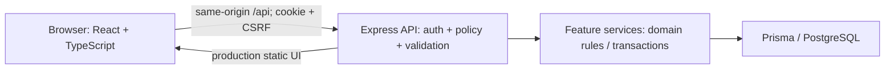
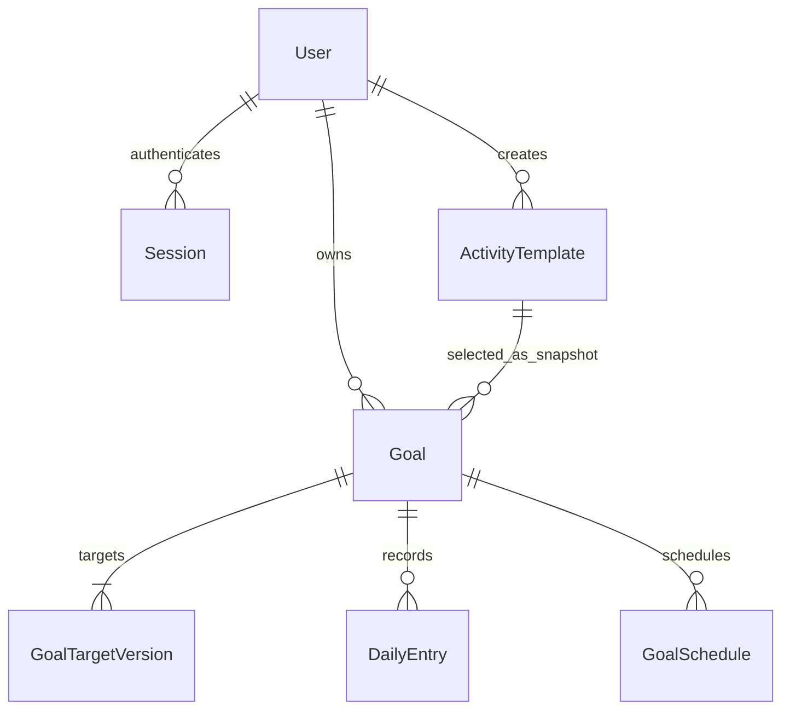

# StudyTrack — System-Level Software Design Specification

Version 0.1, 3 November 2026. Member A pre-code design; now implemented for A foundation/F-01/F-03 on `codex/member-a-sprint1`, teammate review still pending. [Current verification and gaps](verification/member-a.md). อ้างอิง [SRS](srs.md), [integration contract](integration-contract.md) และ [decisions](decisions.md)

## 1. Architecture



Modular monolith: React/Vite frontend, Express/TypeScript backend, PostgreSQL/Prisma persistence. Client ไม่มี authority เรื่อง role/owner/target calculation. API validates request; service enforces rules and transactions; database constraints protect invariants โดยเฉพาะ concurrent mutations

Dev ใช้ UI port 3000, API 5000, Vite proxy `/api` ให้ browser เห็น origin เดียวกัน Production เสิร์ฟ built UI และ API จากแอปเดียวกัน; ออกแบบให้ทำ Docker image เดียวได้ DB เป็น durable service แยก ไม่เก็บลง container filesystem ไม่บังคับสาม containers

## 2. Proposed source layout and ownership

```text
client/src/{api,auth,components,features/templates,features/goals,features/entries}
server/src/{app,config,auth,errors,features/templates,features/goals,features/entries}
server/prisma/{schema.prisma,migrations,seed.ts}
server/tests/{unit,integration}
e2e/
docs/
```

Directories/code ของ A มีแล้ว; actual mounts และ shared signatures อยู่ใน [implementation handoff](handoffs/member-a-implementation.md). B ไม่ต้องสร้าง scaffold อีกชุด A ประสาน schema/migrations/auth/test harness; B ต่อ UI layout/router ของ feature ตนโดย review การเปลี่ยนร่วม; feature files เป็นเจ้าของตาม team plan

## 3. Logical data model

IDs เป็น UUID strings; DB names ใช้ snake_case, JSON ใช้ camelCase. Audit timestamps เป็น timestamptz/UTC; domain dates เป็น PostgreSQL DATE และ JSON YYYY-MM-DD

| Entity | Fields / relationships | Constraints |
|---|---|---|
| User | id, emailNormalized, displayName, passwordHash, role, createdAt | unique emailNormalized; role PARTICIPANT/PROGRAM_MANAGER; ไม่มี password ใน public DTO |
| Session | id, tokenHash, csrfToken, userId nullable, createdAt, expiresAt | tokenHash unique; opaque token ไม่เก็บตรง ๆ; null userId สำหรับ pre-auth CSRF bootstrap; cascade revoke/delete เมื่อ account ถูกลบ |
| ActivityTemplate | id, title, description, unit, minMinutes, maxMinutes, isActive, createdById, createdAt, updatedAt | unit MINUTES; 1<=min<=max<=1440; FK manager creator; title length 1..100 |
| Goal | id, ownerId, templateId, templateTitleSnapshot, unit, minMinutesSnapshot, maxMinutesSnapshot, startDate, endDate nullable, status, createdAt | FK owner/template; status ACTIVE/ARCHIVED; partial unique(ownerId,templateId) WHERE status=ACTIVE; bounds snapshots immutable |
| GoalTargetVersion | id, goalId, effectiveFrom, targetMinutes, createdAt | unique(goalId,effectiveFrom); target>0; initial effectiveFrom=startDate; effective version query ordered descending <= requested date |
| DailyEntry | id, goalId, entryDate, minutes, createdAt, updatedAt | unique(goalId,entryDate); minutes 1..1440 and service checks goal snapshot range/date; no client owner field |
| GoalSchedule (S3, planned logical model) | goalId, weekday, localTime | weekday1..7 and local HH:mm; proposed current-config/weekday-child normalization, reminder fields and locking are specified in the [F07 pre-code contract](sprints/sprint-3/f07-schedule.md); no schedule migration/model exists yet |



Application constraintsที่ขึ้นกับหลายตาราง เช่น template active, goal owner role และ goal snapshot bounds ต้องตรวจใน service transaction ไม่อ้างว่า FK ป้องกันทุกกรณี. ใช้ SQL migrations เพิ่ม partial unique/check constraints หาก Prisma schema แทนทั้งหมดไม่ได้

สร้าง goal + initial target version atomically; unique violation แปลง 409 ไม่คืน DB internals. Race inactive template/create goal ใน S2 ต้องใช้ template row lock และตรวจ active ใน transaction ทั้งฝั่ง deactivate/create; B ต้องรักษา lock order เดียวกันตาม future contract. S1 ยังไม่มี deactivate endpoint

Goal bounds/title snapshots เป็น authoritative historical context; ไม่คำนวณ goal เก่าจาก template ล่าสุด. Target สำหรับอนาคตก่อน startDate ไม่ถูกนำไปคิด entry ที่ยังไม่มีสิทธิ์สร้าง

## 4. Authentication and session lifecycle

- ใช้ Argon2id library พร้อม unique salt, minimum memory 19456 KiB, iterations 2, parallelism 1; benchmark implementation จริงก่อนยอมรับค่า production ไม่สร้าง custom password crypto
- password seed มาจาก private local env ห้าม commit; fixtures สำหรับ tests สังเคราะห์ได้; invalid login คืน generic message เหมือนกันทั้ง wrong email/password
- `GET /api/auth/csrf` ให้ anonymous ได้ pre-auth session อายุ 30 นาทีและ random CSRF token; ไม่ส่ง user identity. Existing unexpired authenticated session ใช้ token เดิม
- Session ID เป็น cryptographically random 32 bytes base64url; เก็บ SHA-256 digest เป็น tokenHash ใน DB. CSRF token random แยกจาก cookie token; เก็บ server-side และไม่ log
- login valid ต้อง invalidate pre-auth/current session แล้วออก authenticated session และ CSRF token ใหม่; fixed expiry 8 ชั่วโมง ไม่ sliding refresh. role อ่านจาก trusted user record ไม่รับ client payload
- Cookie ชื่อ `studytrack.sid`, HttpOnly, SameSite=Lax, Path=/, ไม่ตั้ง Domain; Secure=true บน HTTPS/production; dev HTTP loopback อนุญาต Secure=false. ไม่มี tokens ใน localStorage
- `GET /api/auth/me` validate session/expiry แล้วคืน safe user DTO. server clock ตรวจ expiry ทุก request
- logout ลบ current server session แล้ว clear cookie; session เดิมใช้ไม่ได้. expired/unknown token คืน 401 และ clear stale cookie; หลาย sessions ต่อบัญชีใช้ได้และ logout กระทบ session ปัจจุบัน
- Unsafe methods ต้องตรง configured APP_ORIGIN และส่ง `X-CSRF-Token` ที่ตรง session; same-site cookie เป็น defense เพิ่ม ไม่ใช้แทน CSRF check. GET/HEAD ไม่แก้ domain state; CSRF bootstrap เป็น security session setup เท่านั้นและตอบ no-store
- ไม่เปิด permissive credentialed CORS; production same-origin. API tests ต้องส่ง Origin/header ตามที่ browser ใช้ ทดสอบ missing/wrong token/origin โดยไม่มี state mutation
- auth routes ส่ง `Cache-Control: no-store`; logs redact cookie/authorization/password/csrf. Login UI/error ไม่แสดง stack/DB details

## 5. Role and ownership matrix

| Operation | Anonymous | Participant | Program Manager |
|---|---|---|---|
| Bootstrap CSRF/login | allowed | allowed/rotates on valid login | allowed/rotates on valid login |
| Current user/logout | 401 | own session | own session |
| List/read active templates | 401 | allowed | allowed |
| List inactive/create/manage templates | 401 | 403 | allowed; baseline manager manages all shared templates |
| Create/list goals | 401 | own only | 403 |
| Read goal/entries/history/schedule/summary | 401 | own only; cross-owner/absent 404 | 403 |
| Mutate personal records | 401 | own only + valid CSRF | 403 |

Policy middleware order: authenticate → role → CSRF/Origin for unsafe → payload validation → owner-scoped lookup → domain validation/transaction. Anonymous invalid mutation still 401; authenticated wrong role 403; own missing record and other-owner record indistinguishable 404

## 6. UI structure and conventions

Routes: `/login`, `/templates`, `/goals`, `/goals/new`, `/goals/:goalId`, `/manager/templates`. S2 adds history/goal revision controls; S3 adds schedule/summary. B refines screen/layout conventions without silently changing shared payloads

Login labelled email/password fields; no role dropdown. Role-specific navigation derived from `/auth/me`. Unauthorized navigation shows safe message/redirect; backend remains authoritative. Every fetch has loading/empty/error/success state, submit pending disables duplicate UI actions, field validation preserves input. Server unique constraints still handle concurrency

Date controls display Bangkok local date and send date-only string. Minutes integer input. Critical content usable at 390×844 and 1440×900; errors linked to fields, keyboard focus visible. 401 clears client auth state, offers login and does not automatically replay protected mutation; 403/404 do not reveal hidden personal data

## 7. API and shared integration

Detailed shapes/status codes in [integration contract](integration-contract.md). Unknown payload keys rejected rather than accepted as owner/role overrides; pagination bounded; output DTO explicit. Request body cap 16 KiB, request ID for troubleshooting, safe error envelope and no private values in error messages

Own lookup uses `WHERE id=:id AND ownerId=:identity` before joins. Collections always scoped. Manager permission does not bypass ownership. No mass assignment from request body into ORM

## 8. Configuration, migrations and seeds

Proposed env names: `DATABASE_URL`, `TEST_DATABASE_URL`, `APP_ORIGIN`, `PORT`, `NODE_ENV`, `SEED_MANAGER_PASSWORD`, `SEED_PARTICIPANT_PASSWORD`. Only placeholders in `.env.example`; no actual env file needed for document phase

Local database `studytrack_dev`, test database `studytrack_test`; test runner must fail if test target equals dev or lacks explicit test marker. UUID IDs/DB credentials are not copied from TokTickIT. Isolated test setup seeds synthetic users/templates and removes only test-owned data

Seed upserts users by normalized email with consistent roles and hashes env-provided passwords; rerun no duplicate accounts. Separate fixtures create at least two participants, manager, active template; feature tests must exercise manager-created template too, not only seeded templates. Applied migrations are immutable; future change is new migration

README มีคำสั่ง setup/build/tests ที่ใช้จริงแล้ว; actual output/version อยู่ใน verification artifacts. ไม่มีการถือ design plan เป็น PASS ของฟีเจอร์ที่ยังไม่ได้ทำ

## 9. Deployment and verification plan

Lab 5: build/test PR checks + failed required gate demonstration on temporary branch; Docker build/run; accepted main deployment via repeatable pipeline; post-deploy normal/rejection/permissions and durable-data restart/redeploy checks

Possible GCP target is container hosting plus managed PostgreSQL; exact services/access/cost remain pending course guidance. Configure HTTPS/cookies/proxy trust for real ingress, external DB env/secrets, health endpoint without secrets and migrations as controlled release step

Unit: date/validation/progress/target selection; API+PostgreSQL: auth/session/ownership/constraints/transactions; selected browser E2E: full critical journey. Commit/run/counts/actual names are recorded after execution. Independent UAT and retests belong to real other-team testers, not Codex-generated signoff

## 10. Primary references used for design

- [OWASP Password Storage](https://cheatsheetseries.owasp.org/cheatsheets/Password_Storage_Cheat_Sheet.html): Argon2id parameters and salted password hashing
- [OWASP CSRF Prevention](https://cheatsheetseries.owasp.org/cheatsheets/Cross-Site_Request_Forgery_Prevention_Cheat_Sheet.html): synchronizer token, custom header, Origin and cookie defenses
- [PostgreSQL partial indexes](https://www.postgresql.org/docs/current/indexes-partial.html): unique predicate for one active goal

References support engineering choices; they do not establish implementation or passing verification
